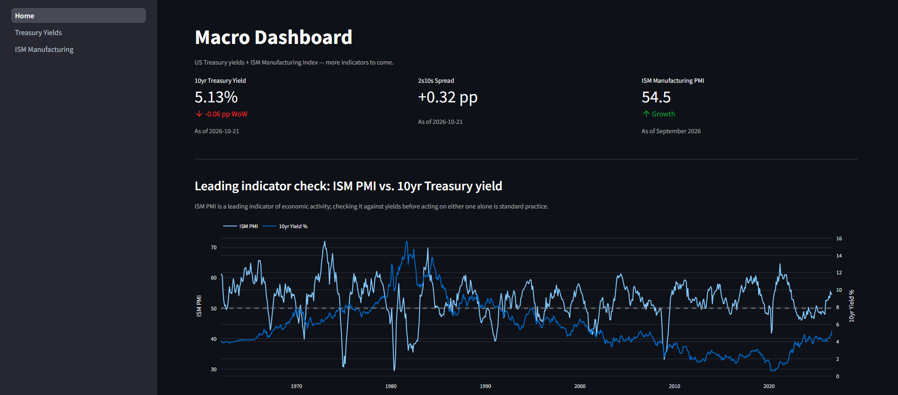

# Macro Dashboard

A Streamlit dashboard that reads the US macro regime from the Treasury yield
curve and the ISM Manufacturing PMI, with every number traced to its source.

**Live app:** https://mo-macro-dashboard.streamlit.app



## What it shows

**Treasury Yields & Curve.** The yield curve is one of the most reliable
leading indicators of the US cycle: the 2s10s spread compresses or inverts as
markets price policy tightening and slower growth, and re-steepens ahead of
easing. The page shows yields and their weekly, monthly, quarterly and yearly
changes for every tenor from 1 month to 30 years, curve snapshots across
dates, any tenor-against-tenor spread over time, and breakeven inflation
(nominal minus TIPS yields).

**ISM Manufacturing PMI.** A diffusion index where 50 separates expansion
from contraction. It leads industrial production and corporate earnings, and
its New Orders and Prices components are watched for turns in growth and
inflation. The page shows the headline and all ten sub-indices since 1948, a
sub-index heatmap, which manufacturing industries are growing or contracting
each month, and a reconstruction of the headline from its weighted
components.

**Home** sets the PMI against the 10-year yield, a cross-check between the
growth signal and the rates market.

### How the signals work

Each indicator produces one reading in a common format (level, change,
z-score, direction, regime and a one-line market read), dated to its last
complete observation.

- **Curve regime.** The four-week change in the 2s10s spread is combined with
  the direction of the overall yield level: *bull steepener* (yields falling,
  front end faster), *bear steepener*, *bull flattener* or *bear flattener*.
  Moves within ±10bp count as range-bound.
- **ISM regime.** The PMI's level against 50 is combined with its momentum
  (the latest three-month average against the prior three months) to give
  *Expansion*, *Slowdown*, *Contraction* or *Recovery*. Momentum within ±1.0
  point is treated as stable, and the prior month's direction carries
  forward, so the regime does not flip on noise. Readings above 55 or below
  45 are flagged as extreme, and a note appears when the PMI has fallen at
  least 1 point from its three-month high.
- **Z-score.** Each level is compared with its own trailing ten years, so a
  reading can be judged against its recent history rather than a fixed
  threshold.

## Data sources

| Source | Series | Update frequency | Licence / attribution |
|---|---|---|---|
| U.S. Department of the Treasury | Daily par yield curve rates: nominal 1m–30y, real (TIPS) 5y–30y | Daily (weekly history before 2026) | Public U.S. government data |
| FRED, Federal Reserve Bank of St. Louis | EFFR, effective Fed Funds rate | Daily | Subject to FRED's terms of use |
| Institute for Supply Management | Manufacturing PMI and 10 sub-indices (1948 on); industries reporting growth or contraction (from April 2026) | Monthly | Source: ISM Manufacturing Report On Business (Institute for Supply Management). 1948–Sep 2026: ISM monthly releases (ismworld.org), with historical data via Investing.com and Quandl. |

Per-file details are in [`data/README.md`](data/README.md).

## How I check the data

- **Treasury yields:** compared cell by cell with Treasury.gov's own yield
  curve files for 1990–2026: 21,874 nominal and 6,555 TIPS values, 0
  mismatches. Rows added since were checked the same way (416 Treasury values,
  and 26 Fed Funds values against FRED), also with 0 mismatches. The checks
  found and fixed three problems in the stored history: TIPS yields missing
  for 2026, a 3-month series that had come from a different rate on 228 weekly
  dates, and one weekly snapshot holding a stale close.
- **ISM:** compared with the cached values in the source workbook: 8,286
  values across all 11 series and every month since 1948, 1,716 cells of the
  workbook's own heat-map summary, and 432 industry rankings, with 0
  mismatches.
- **Calculations:** 170+ automated tests, including known values from the
  official releases, missing-data cases and the signal format.

## Architecture

```
data/yields/, data/ism/   committed CSVs (one folder per dataset)
        │
        ▼
src/core/                 paths, loaders, shared maths, chart builders, signal schema
src/modules/<indicator>/  config.py (series, thresholds, labels)
                          calculations.py (pure functions: DataFrame in, DataFrame out)
        │
        ▼
Home.py, pages/           Streamlit UI only
```

Every module's `get_signal()` returns the same record, so the landing page can
combine indicators into one regime scorecard. Thresholds and labels live in
each module's `config.py`, never in the calculations.

## Run it locally

```
git clone https://github.com/Mo-Heidari1/macro-dashboard.git && cd macro-dashboard
pip install -r requirements.txt
python -m streamlit run Home.py
```

The app runs from the committed data; no key is needed to view it. Refreshing
the Treasury data (`python scripts/update_yields.py`) needs a free
[FRED API key](https://fred.stlouisfed.org/docs/api/api_key.html), read from
the `FRED_API_KEY` environment variable or from `.streamlit/secrets.toml`:

```
FRED_API_KEY = "your-key"
```

Dependencies are pinned for Python 3.12.

## Roadmap

Next modules, in build order: credit spreads (IG and HY option-adjusted
spreads), Fed policy and liquidity (Fed Funds, M2, the Fed's balance sheet),
CPI and PPI, the trade-weighted dollar, ISM Services, consumer sentiment,
building permits, euro-area benchmark yields, the EU Economic Sentiment
Indicator, CFTC positioning, China PMIs, NFIB small-business optimism and a
commodities basket. Once five or more modules report signals, the landing
page will combine them into a single regime scorecard.

## Licence

The code is released under the [MIT License](LICENSE). The data belongs to
its sources (the U.S. Department of the Treasury, the Federal Reserve Bank of
St. Louis and the Institute for Supply Management) and remains subject to
their terms; see the attribution above.

---

**GitHub description:** Macro regime dashboard: US Treasury yield curve and
ISM Manufacturing PMI signals, validated against their sources (Streamlit).

**Topics:** `macroeconomics` `streamlit` `quantitative-finance` `python` `fred-api`
